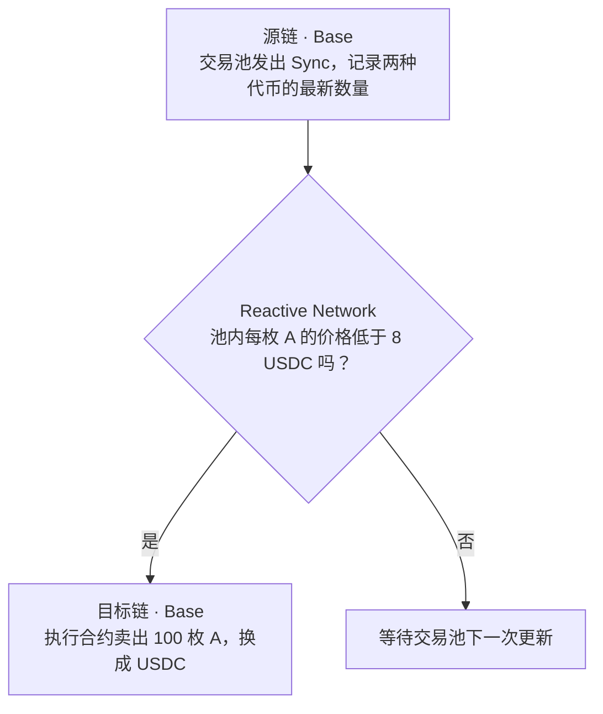

# D1 用例拆解卡 · ReacDEFI 自动止损

我选的是 ReacDEFI 在 Base 主网上提供的自动止损功能。假设我持有代币 A，想在它的价格跌破每枚 8 USDC 时卖出 100 枚。价格和数量是举例用的；下面的事件流程参照 Reactive 官方的 Uniswap V2 止损示例。[ReacDEFI 案例](https://blog.reactive.network/reacdefi-for-on-chain-stop-orders-and-beyond-2/) · [官方止损示例](https://github.com/Reactive-Network/reactive-smart-contract-demos#uniswap-v2-stop-order-demo)

**1. 监听哪条链、哪个合约的什么事件？**

监听 Base 主网上选定的 A/USDC 交易池合约发出的 `Sync` 事件。它记录池子里两种代币最新各有多少。例如，有人卖入 A 换走 USDC，池子里的 A 会增加，USDC 会减少。Reactive 合约可以根据这两个数量算出池内每枚 A 约值多少 USDC。

**2. 满足什么条件时触发？**

收到更新后，检查这张仍然有效的止损单。如果算出每枚 A 值 8.3 USDC，就继续等；如果是 7.9 USDC，就触发卖出。收到池子更新时总要判断一次，只有价格低于设定的 8 USDC 才请求执行这张订单。

**3. 在哪条链做什么动作？**

Reactive 网络把执行请求送回 Base 主网。Base 上的执行合约使用我预先给的代币授权，通过 Uniswap 把 100 枚 A 换成 USDC。8 USDC 是触发线，实际能换回多少取决于交易执行时的池内价格和兑换成本。

**4. 不用 Reactive 会怎么做，使用它又有什么代价？**

我可以自己盯着价格，跌破 8 就打开钱包卖出；也可以自己运行一个机器人，让它一直检查这个池子、在符合条件时发交易。用 Reactive 后，网络负责监听和触发，我省去了看盘和维护机器人的工作。代价是需要提前设置订单、授予执行合约相应的代币额度，并为 Reactive 上的判断和 Base 上的执行准备手续费；相关合约欠费时，自动化会暂停。[官方费用说明](https://dev.reactive.network/economy)

**源链 → Reactive → 目标链**

